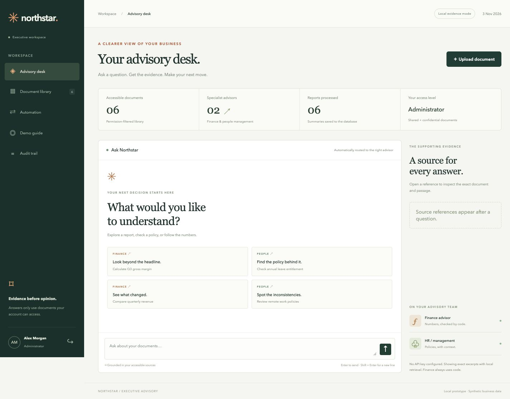

# Northstar Executive Advisory

> © 2026 Mohammed Shaheem Abdul Salam. All rights reserved. Provided for assessment evaluation only — see [LICENSE](LICENSE).

A local proof of concept for the **Personal AI & Digital Operations Executive** practical assessment. Upload synthetic business documents, ask source-grounded questions, calculate financial metrics in Python, and demonstrate permission-filtered retrieval.



## Start here

Requires **Python 3.12**, pip and a modern browser. No Node.js, vector database or API key is required for the local evidence-mode demonstration.

```bash
cd advisory-system
python3 -m venv .venv
source .venv/bin/activate
python -m pip install -r requirements.lock
python -m uvicorn app.main:app --host 127.0.0.1 --port 8000
```

Open [the local dashboard](http://127.0.0.1:8000). On macOS/Linux, `./run.sh` performs the same setup and starts the server. Ensure `python3 --version` is 3.12 or select `python3.12` explicitly when creating the environment. On Windows use `.venv\Scripts\Activate.ps1` instead of the `source` command. Stop the server with Ctrl+C.

The first start creates `data/northstar.db`, two demo accounts and six synthetic documents. No original employer files are used. Demo passwords are intentionally public and **must not be used for an internet-facing service**.

| Account | Password | Permissions |
|---|---|---|
| `admin` | `AdminDemo!2026` | Upload, inspect shared/confidential documents, retry failed jobs, view audit metadata |
| `user` | `UserDemo!2026` | Ask questions and inspect shared documents and their summaries |

## Two honest operating modes

**Local evidence mode, enabled by default:** BM25-style lexical retrieval selects exact source excerpts. This is a deterministic fallback, not a running language model. Routing, conflict checks, calculations, access control and upload automation all work in this mode.

**AI evidence selection, optional:** Set an OpenAI API key on the server and restart. The Responses API selects relevant exact quotes from already-authorized chunks. The server validates each quote and citation against its original chunk. Empty selections produce an insufficient-evidence answer; API errors or invalid selections produce a labelled local fallback. Finance arithmetic always runs in Python, even with AI enabled.

```bash
export OPENAI_API_KEY='your-own-key'
export OPENAI_MODEL='gpt-4.1-mini'
python -m uvicorn app.main:app --host 127.0.0.1 --port 8000
```

Use a model your account supports with Responses and strict structured output. The example is configurable, not a claim about the latest or best model. Environment variables are read directly; `.env.example` documents options but is not auto-loaded. Never put an API key in browser code or commit it. AI mode transmits the question and authorized retrieved excerpts to OpenAI; only use synthetic content for this assessment. Requests set `store=false`; provider-side retention rules still apply. No paid live-model call was made during verification. API shape, success, errors and invalid output were tested with an HTTP mock.

## Assessment coverage

| Requirement | Working implementation |
|---|---|
| Knowledge assistant | PDF, Word `.docx` and UTF-8 `.txt`; chunk locations, clickable sources, insufficient-evidence responses |
| Finance advisor | Financial retrieval; Decimal gross profit/margin, operating profit/margin, revenue growth and cash runway; formulas, inputs and discrepancy warnings |
| HR / management advisor | Policy excerpts, missing-topic checks, conflicting labelled policy facts with both sources |
| Automatic routing | Transparent keyword router; mixed-domain questions request separate questions |
| Security | Database-backed roles; authorization before retrieval, before provider calls and on source/summary reads |
| Automation/integration | Upload → extract/index → durable SQLite job → extractive summary persisted in database; status, retry and restart recovery |
| Dashboard | Sign-in, advisory desk, document library, upload dialog, automation records, admin audit trail |
| Reliability | 55 automated checks, browser walkthrough, corrupt-file handling, provider fallback and tested financial edge cases |
| Submission | Downloadable source, captioned visual demo, architecture diagram, deployment notes and AI-assistance disclosure |

The database automation satisfies the assessment's explicit **database** integration option. No email is sent and no external workflow service is required.

## Suggested demonstration

1. Sign in as Administrator and ask **What is the gross margin for 2026-Q3?** The result is **40.00%**, with a warning that the document reports 45%. Open a reference.
2. Ask **Compare revenue growth from 2026-Q2 to 2026-Q3.** Expected: **20.00%**.
3. Ask **How many annual leave days do employees receive?** Expected: **24 working days** and a source.
4. Ask **What is the remote work policy?** Expected: a conflict between **2** and **3** days, without choosing a winner.
5. Ask **What is our parental leave policy?** Expected: insufficient evidence.
6. Upload `sample_documents/finance_Q4.pdf` as **Finance / Shared**. Open Automation to see the stored summary, then ask **What is gross margin for 2026-Q4?** Expected: **46.00%**.
7. Upload `sample_documents/travel_training_policy.docx` as **HR / Management / Shared** and ask **What is the training budget?**
8. Ask **What is the executive salary?** As Administrator the answer contains the synthetic AED 85,000 figure. Copy the confidential document's ID from the source response URL for a direct-access test.
9. Sign out, sign in as Standard User and ask the same question. Expected: insufficient evidence, no restricted citation, and no confidential item or summary in the library. Opening `/api/documents/<copied-id>` returns the same 404 response as a nonexistent ID.

`docs/DEMO_SCRIPT.md` gives a narration outline under 10 minutes. `docs/demo.mp4` is a 2-minute 57-second captioned visual walkthrough built from actual local browser screens; it is not a narrated candidate presentation or a live paid-model demonstration. `docs/demo.srt` contains the captions as text.

## Financial report contract

Calculations accept labelled lines from any supported upload format. Use one period, one currency, one consistent Scope per report. Amounts must be full units, nonnegative, finite numbers with up to two decimals. Comma grouping is supported. Parenthesized negatives, amounts such as “1.2 million”, multiple reporting entities, tables with ambiguous headings and currency conversion are deliberately unsupported.

```text
Period: 2026-Q4
Currency: AED
Revenue: 1,500,000
Cost of goods sold: 810,000
Operating expenses: 340,000
Cash balance: 720,000
Monthly net burn: 120,000
Reported gross margin: 46%
Scope: Whole company, standalone quarter, amounts in full currency units.
```

The Scope label must match across reports being combined. Sources that claim the same scope can still be factually wrong; a human must validate their accounting basis. When no period is specified the latest available period is shown explicitly. Growth uses two specified periods, or the latest two available periods. Conflicting values, missing inputs, incompatible scopes/currencies and invalid denominators stop the calculation. Only the six listed operations are supported; net profit, tax and EBITDA are not inferred.

## Tests

```bash
python -m pip install -r requirements-dev.txt
python -m pytest -q
```

The suite uses temporary databases and HTTP mocks; it does not spend API credits or modify your demo database. See `docs/TEST_RESULTS.md` for observed results and verification limits.

## Source map

```text
app/main.py          HTTP endpoints, authentication, CSRF, role checks
app/db.py            SQLite schema, scrypt passwords, authorization helpers
app/ingest.py        Bounded parsers, chunking and database automation
app/retrieval.py     Authorization-filtered lexical retrieval
app/advisors.py      Routing, grounded responses and HR conflict checks
app/finance.py       Labelled metric extraction and Decimal calculations
app/provider.py      Optional Responses API and exact-quote validation
app/static/          Buildless dashboard, no external browser dependencies
sample_documents/    Synthetic shared and confidential test documents
tests/               Security, correctness and failure-path tests
docs/                Architecture, demo, deployment and interview notes
DISCLOSURE.md        Accurate AI-assistance and contribution statement
```

See `docs/ARCHITECTURE.md` and `docs/architecture.svg` for the system diagram, `docs/DEPLOYMENT.md` for deployment and expansion, and `docs/TECHNICAL_WALKTHROUGH.md` for the interview preparation guide.

## Limits and tradeoffs

- This is a single-process proof of concept, not a production-ready platform. Keep it on loopback with synthetic data. No SSO, MFA, tenant isolation, account management or password-reset flow is included.
- Local retrieval is lexical, English-oriented and evaluated on a small synthetic corpus. Relevant paraphrases may be missed. A cited excerpt is traceable evidence, not proof that the whole question is answered. General semantic contradiction detection is not implemented.
- HR conflict checks compare labelled facts for known topics such as `Remote work:`. Equivalent wording can be conservatively flagged. Different effective dates do not establish precedence automatically.
- Scanned/image-only PDFs need OCR first; legacy `.doc`, encrypted PDFs and embedded-image text are unsupported. Original upload bytes are not retained; extracted text and page/line locations are stored. Word citations do not claim Word page numbers.
- Parsing is bounded by 5 MB input, 80 PDF pages, 15 MB DOCX expansion and 250,000 extracted characters, but is not isolated in a resource-limited process. Untrusted public uploads require a stronger parser sandbox before deployment.
- Summary jobs are durable SQLite records, executed in the FastAPI process. Pending/interrupted jobs recover on restart; failed jobs require an admin retry. There is no separate queue worker, retry backoff or external notification delivery.
- The database is permission-restricted on disk but not application-encrypted. Audit records are editable by anyone who controls that file. An administrator controls confidential access by choosing the upload's classification; document reclassification and deletion are not implemented.
- Live OpenAI connectivity and container deployment need validation in the intended environment. The provided Dockerfile was not executed here.

## Reset and troubleshoot

For a fresh disposable demonstration, stop the app, **back up any uploads you want to retain**, then remove only this project's `data/` directory and restart. It contains all documents, sessions, jobs and logs. Seed documents return only in demo mode. Do not perform this reset on real data.

If the port is occupied, choose `--port 8001` or `PORT=8001 ./run.sh`. If a PDF has no text, use an unlocked, text-based synthetic copy. If a query returns insufficient evidence, check the upload category and exact supported labels. If AI fails, inspect the visible fallback warning, the server's key/model settings and the admin `provider failure` event. No raw provider error or API key is returned to the browser.

## Documentation references

The optional provider uses the official [Responses API](https://developers.openai.com/api/reference/resources/responses/methods/create) and [Structured Outputs guide](https://developers.openai.com/api/docs/guides/structured-outputs?api-mode=responses). FastAPI is the HTTP framework; see its [official documentation](https://fastapi.tiangolo.com/). The app sends bounded raw upload bytes rather than multipart forms.

## Contribution disclosure

Read **DISCLOSURE.md** before submitting. OpenAI Codex generated and tested this implementation in this session. This package does not claim that the candidate independently wrote or has already reviewed the code. The candidate should review, modify, explain and troubleshoot it, then accurately record their own contributions and any other assistance.

## License

Copyright © 2026 Mohammed Shaheem Abdul Salam. All rights reserved.

This project is shared only so the recruitment assessment can be evaluated. Commercial use, modification for production, or redistribution requires the author's written consent. See [LICENSE](LICENSE) for the full terms. Third-party libraries keep their own licenses.
