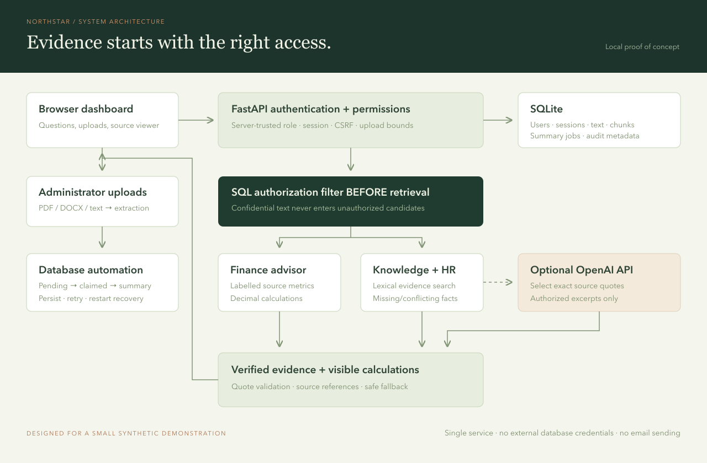
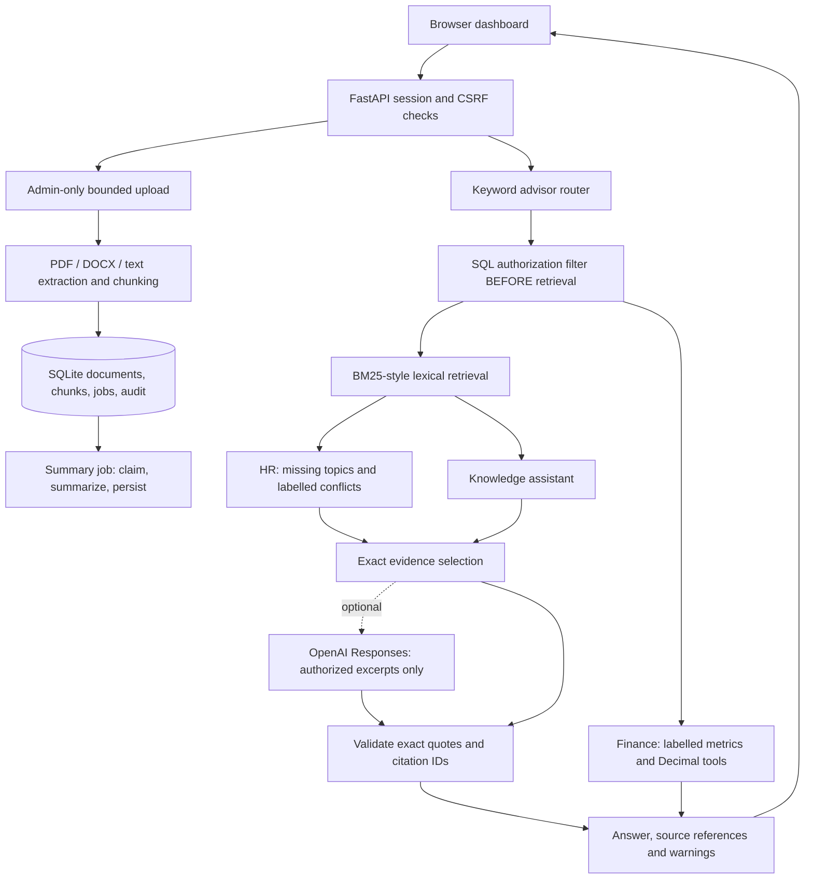

# Architecture

Northstar keeps the entire assessment in one small web service and one SQLite database. The browser contains presentation code; document permissions, roles, advisor selection and calculations are enforced on the server.

The editable vector version is `architecture.svg`.

## Request path

1. A random session token is stored in an HttpOnly, SameSite=Strict cookie. SQLite stores its SHA-256 digest, user association, CSRF token and eight-hour expiry. Each request resolves the role from the users table; a browser-supplied role is ignored.
2. Unsafe authenticated requests require a CSRF header. An Origin check rejects cross-origin writes, and a Host allowlist helps reject unexpected hostnames. Passwords use salted scrypt hashes. Local demo cookies use HTTP; non-demo startup requires Secure cookies and custom passwords.
3. The router recognizes Finance, HR/Management and general knowledge. Questions spanning Finance and HR request clarification. This is a keyword router, not a multi-agent framework.
4. Both the retrieval query and the finance report query apply `(access='public' OR role='admin')` in SQL before processing text. The same condition protects source document reads and summary listings. The optional model receives only the already-filtered top chunks. There is no cross-user answer cache or server-side conversation memory.
5. For supported financial intents, the server reads a strict labelled schema, checks periods/scopes/currencies, reconciles duplicate metrics, and computes with Decimal. Results carry formulas, inputs, rounding and original metric references. No `eval`, generated Python or model arithmetic is used.
6. For HR questions, known policy topics trigger evidence-presence checks and comparison of labelled facts across all accessible HR chunks. A conflict returns both sources and asks an owner to resolve precedence.
7. Knowledge and non-conflicting HR answers show source excerpts. Without a key, a deterministic selector chooses excerpts. With a key, the model chooses quotes using strict structured output. Quote text must occur in its cited retrieved chunk. Provider errors, incomplete output and unverifiable citations trigger an explicitly labelled local fallback. Empty model selections preserve an insufficient-evidence response.

## Upload and automation

Uploads are Administrator-only raw HTTP bodies with filename/category/access query parameters. This avoids a multipart parser dependency. The server streams and caps input, validates filenames and extracts text in the framework's thread pool. A transaction inserts the document, chunks and pending job together. A content hash prevents duplicate uploads with the same access and category.

A background task atomically claims the durable job, increments its attempt count, creates an extractive summary and updates the SQLite record. A completed job is idempotent. Errors store a safe failure message; admins can retry. Startup resets interrupted `processing` jobs to `pending` and runs pending jobs. This implements the requested database automation without credentials for another service.

## Data model

| Table | Purpose |
|---|---|
| users | Credentials and server-trusted roles |
| sessions | Hashed cookie tokens, CSRF and expiry |
| documents | Extracted text, classification, category and hash |
| chunks | Searchable passages and page/line source locations |
| jobs | One durable summary record per document, attempts and status |
| audit | Event metadata without questions or document bodies |

Read `DEPLOYMENT.md` for maintenance and expansion. No data leaves the machine in local evidence mode. In AI mode the authorized retrieved excerpts and user question leave the server for OpenAI. Text embedded in documents is treated as data; it cannot choose URLs, change roles, run tools or execute code. Exact quote validation reduces invented claims, but it does not prove that a quote answers every aspect of a question.
